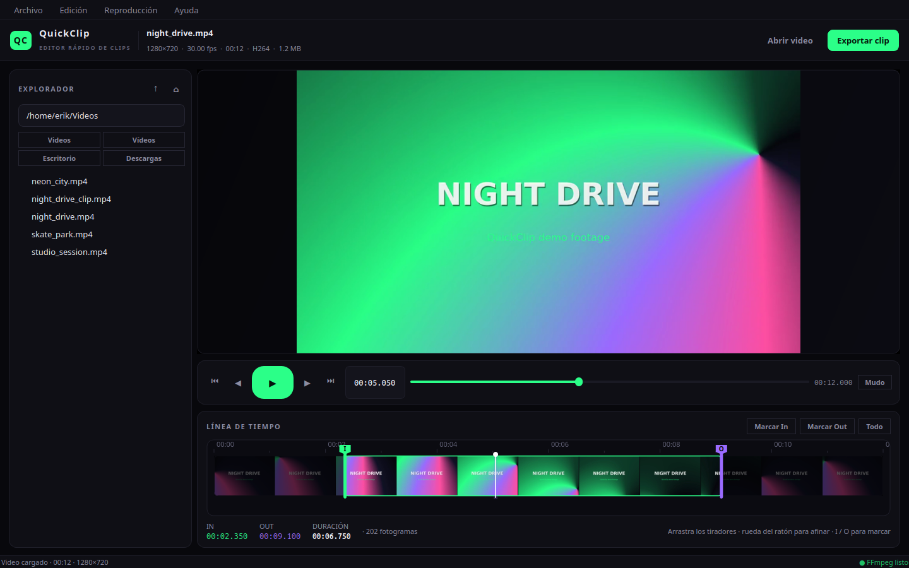
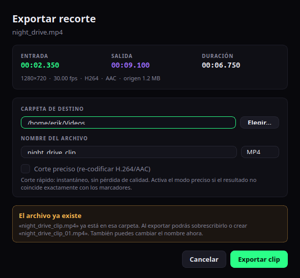

<div align="center">

# QuickClip

**Abre un video, marca In y Out, exporta el clip. Sin líneas de tiempo infinitas.**

Editor de video de escritorio para **Linux**, con soporte principal en Ubuntu, rápido y minimalista, con una interfaz
oscura de acentos neón. Construido con **PyQt6** y **FFmpeg**.


<a href="docs/screenshot-main.png">
  
</a>

<sub>Explorador integrado, previsualización y línea de tiempo con fotogramas reales.</sub>

</div>

---

## Por qué QuickClip

- **Corte en segundos:** abre un archivo, mueve dos tiradores y exporta.
- **Corte siempre preciso:** respeta los marcadores In/Out al fotograma y conserva la máxima calidad.
- **Audio sin recodificar:** mantiene la pista original cuando el contenedor lo permite.
- **Todo local:** sin cuentas, sin subidas y sin telemetría. Tus videos no salen de tu equipo.
- **Pensado para Linux:** rutas nativas, accesos a `Videos`, `Captures`, `Escritorio` y `Descargas`, integración con el menú de aplicaciones y comprobación de FFmpeg al iniciar.

## Capturas

<div align="center">
  
  <br>
  <sub>Exportación con carpeta y nombre editables, aviso de archivo existente y renombrado automático.</sub>
</div>

## Características

### Explorador y carga
- Explorador de archivos integrado con vista de árbol y filtro de videos.
- Barra de ruta editable, botones de subir/inicio y accesos rápidos a carpetas habituales.
- Arrastrar y soltar un video (o una carpeta) directamente en la ventana.
- Apertura desde línea de comandos: `python3 main.py /ruta/al/video.mp4`.

### Previsualización y línea de tiempo
- Filmstrip con miniaturas reales generadas en segundo plano y cacheadas en disco.
- Tiradores **In/Out** arrastrables, playhead y regla de tiempos.
- Vista previa del fotograma al hacer *scrubbing* (sin bloquear la interfaz).
- Play/pausa, salto por fotogramas y audio opcional mediante `ffplay`.
- La reproducción se limita siempre al tramo **In/Out** seleccionado.
- La caché se invalida automáticamente si el video cambia.

### Exportación
- **Corte preciso al fotograma:** recodifica solo el fragmento seleccionado en H.264 CRF 16, con calidad visualmente sin pérdida.
- **Audio conservado:** copia la pista original sin recodificar en MKV o cuando el códec es compatible con MP4/MOV; si no, usa AAC 320 kbps.
- No hay que elegir modos: cada exportación prioriza exactitud y calidad.
- Gestión de colisiones: **sobrescribir** o **crear nuevo** con sufijo automático (`clip_01.mp4`, `clip_02.mp4`, …).
- Carpeta y nombre editables antes de exportar, progreso y cancelación.
- Salidas `.mp4`, `.mkv` y `.mov`, con `+faststart` cuando aplica.

## Requisitos

| Dependencia | Versión recomendada | Notas |
| --- | --- | --- |
| Linux | Ubuntu 22.04+, Fedora o Arch | Probado en Ubuntu 26.04.1 LTS |
| Python | 3.10 o superior | Probado con Python 3.14 |
| PyQt6 | 6.2 o superior | Probado con 6.10; paquete `python3-pyqt6` o `pip install PyQt6` |
| FFmpeg | 5.1 o superior | Incluye `ffprobe`; `ffplay` es opcional, solo para audio del preview |

> QuickClip **no usa QtMultimedia**: decodifica el preview con FFmpeg y lo pinta en Qt.
> Esto evita dependencias multimedia adicionales y funciona bien en Ubuntu/Wayland.

## Instalación

QuickClip está pensado para **Linux**. El instalador crea una instalación por usuario y
comprueba que estén disponibles Python 3.10+, PyQt6, FFmpeg y FFprobe. Si falta algo,
muestra el comando que usaría, **pide confirmación** y lo ejecuta con `sudo`/`doas`.
Nunca instala dependencias de forma silenciosa.

También puedes instalarlas manualmente antes de ejecutar el instalador:

```bash
# Ubuntu / Debian
sudo apt install ffmpeg python3-pyqt6 git

# Fedora
sudo dnf install ffmpeg python3-qt6 git

# Arch Linux
sudo pacman -S ffmpeg python-pyqt6 git

# openSUSE
sudo zypper install ffmpeg python3-PyQt6 git

# Alpine
sudo apk add ffmpeg py3-pyqt6 git
```

`ffplay` es opcional y solo se usa para el audio de la previsualización; normalmente viene
incluido con FFmpeg.

### Instalación recomendada

```bash
git clone https://github.com/ErikWebDeveloper/QuickClip quickclip
cd quickclip
chmod +x install.sh uninstall.sh run.sh
./install.sh
```

El instalador copia la aplicación y crea todo lo necesario en tu carpeta de usuario:

- aplicación: `~/.local/share/quickclip`;
- lanzador: `~/.local/bin/quickclip`;
- entrada de menú: `~/.local/share/applications/quickclip.desktop`;
- icono: `~/.local/share/icons/hicolor/scalable/apps/quickclip.svg`.

Si `~/.local/bin` no estaba en tu `PATH`, el instalador te mostrará la línea que debes
añadir a tu shell. Después podrás abrir QuickClip desde el menú de aplicaciones o con:

```bash
quickclip
quickclip ~/Videos/mi_clip.mp4
```

Opciones útiles:

```bash
./install.sh --no-desktop       # no crea entrada de menú ni icono
./install.sh --no-install-deps  # solo comprueba dependencias, sin ofrecer instalarlas
./install.sh --install-dir "$HOME/Apps/quickclip" --bin-dir "$HOME/.local/bin"
./install.sh --force            # sobrescribe una instalación no reconocida
```

También puedes usar las variables `QUICKCLIP_INSTALL_DIR`, `QUICKCLIP_BIN_DIR`,
`QUICKCLIP_SKIP_DESKTOP=1` y `QUICKCLIP_NO_INSTALL_DEPS=1`. Para actualizar, vuelve a
ejecutar `./install.sh` desde la versión nueva del repositorio.

### Ejecutar desde el repositorio, sin instalar

Si prefieres no instalar nada, ejecuta directamente:

```bash
./run.sh
python3 main.py ~/Videos/mi_clip.mp4
```

Si tu distribución no empaqueta PyQt6 o quieres aislar las dependencias, usa un entorno
virtual. Al ejecutar `./install.sh` con el entorno activado, el lanzador usará ese Python.
Si falta PyQt6 dentro del entorno, el instalador ofrecerá instalarlo con `pip` tras pedir
confirmación; FFmpeg se instala como paquete del sistema si también falta:

```bash
python3 -m venv .venv
source .venv/bin/activate
pip install -r requirements.txt
./run.sh
```

### Comprobar la instalación

```bash
command -v quickclip
test -x "$HOME/.local/bin/quickclip"   # o la ruta que hayas elegido con --bin-dir
ffmpeg -version | head -n 1
ffprobe -version | head -n 1
python3 -c "import PyQt6; print(PyQt6.__file__)"
```

### Desinstalar

```bash
./uninstall.sh
```

El desinstalador elimina la aplicación, el lanzador, el acceso del menú y el icono.
No borra dependencias del sistema, videos ni archivos exportados. La caché y la
configuración se conservan por defecto; para eliminarlas también:

```bash
./uninstall.sh --purge
```

Si instalaste con rutas personalizadas, pasa las mismas opciones al desinstalador:

```bash
./uninstall.sh --install-dir "$HOME/Apps/quickclip" --bin-dir "$HOME/.local/bin"
```

## Ejecutar

Después de instalar:

```bash
quickclip
quickclip ~/Videos/mi_clip.mp4
```

Desde el repositorio:

```bash
./run.sh
python3 main.py
python3 main.py ~/Videos/mi_clip.mp4
```

`run.sh` se puede ejecutar desde cualquier carpeta y respeta las rutas relativas a tu
directorio actual:

```bash
cd ~/Descargas
/ruta/a/quickclip/run.sh mi_video.mp4
```

## Uso rápido

1. **Abre un video** con `Ctrl+O`, haz doble clic en el explorador o arrástralo a la ventana.
2. **Define el recorte**:
   - Arrastra los tiradores **I** y **O** de la línea de tiempo.
   - O coloca el playhead y pulsa `I` / `O`.
   - Pulsa `R` para seleccionar el video completo.
   - Usa la rueda del ratón sobre la línea de tiempo para afinar fotograma a fotograma.
   - Al reproducir, el video solo avanza dentro del tramo **In/Out**; al llegar a Out se detiene.
3. **Exporta** con `Ctrl+E` o el botón **Exportar clip**.
4. Elige carpeta, nombre y formato. Si el archivo ya existe, decide entre **Sobrescribir**
   o **Crear nuevo** (`nombre_01.mp4`, `nombre_02.mp4`, …).

### Atajos de teclado

| Tecla | Acción |
| --- | --- |
| `Espacio` | Reproducir / pausar |
| `I` / `O` | Marcar In / Out en el playhead |
| `R` | Seleccionar el video completo |
| `←` / `→` | Fotograma anterior / siguiente |
| `Shift+←` / `Shift+→` | Retroceder / avanzar 1 segundo |
| `Inicio` / `Fin` | Ir al In / Out del recorte |
| `Ctrl+O` | Abrir video |
| `Ctrl+E` | Exportar recorte |
| `Ctrl+Q` | Salir |

> Los atajos se desactivan mientras escribes en un campo de texto o hay un diálogo abierto.

## Cómo funciona el recorte

QuickClip no ofrece un modo rápido que sacrifique la exactitud: cada exportación se ajusta al fotograma marcado.

- **Video:** `libx264` con `-crf 16` y `-preset medium`, conservando el formato de píxel original cuando es compatible. Calidad visualmente sin pérdida.
- **Audio:** se copia sin recodificar cuando el contenedor lo permite, evitando cualquier pérdida en la pista original.
- **Seek preciso:** FFmpeg hace un pre-roll de un segundo y después busca el punto exacto con `-ss` de salida, manteniendo la duración y los timestamps correctos.
- La recodificación solo afecta al fragmento exportado; el video original nunca se modifica.

## Estructura del proyecto

```text
clip-editor/
├── install.sh           # Instalador por usuario y dependencias
├── uninstall.sh         # Desinstalador
├── main.py              # Punto de entrada y creación de la aplicación
├── run.sh               # Lanzador con comprobación de dependencias
├── requirements.txt     # Dependencias de Python
├── docs/                # Capturas para el README
├── quickclip/
│   ├── assets/          # Icono SVG para el escritorio
│   ├── main_window.py   # Ventana principal, menús, atajos y drag & drop
│   ├── explorer.py      # Explorador de archivos y filtro de videos
│   ├── player.py        # Preview por tubería de FFmpeg y audio con ffplay
│   ├── timeline.py      # Filmstrip, tiradores In/Out y playhead
│   ├── export_dialog.py # Exportación, colisiones y renombrado
│   ├── workers.py       # Hilos de miniaturas, playback y exportación
│   ├── ffmpeg.py        # FFprobe/FFmpeg: metadatos, frames y recorte
│   ├── icons.py         # Iconos vectoriales de la interfaz
│   ├── theme.py         # Paleta y hoja de estilos QSS
│   └── config.py        # Extensiones, rutas y caché
└── tests/
    └── smoke_test.py    # Prueba de humo integral
```

## Desarrollo y pruebas

```bash
bash -n install.sh uninstall.sh
QT_QPA_PLATFORM=offscreen python3 tests/smoke_test.py
```

La prueba de humo genera un video de muestra con FFmpeg y comprueba:

- lectura de metadatos con `ffprobe`;
- extracción de fotogramas y generación de miniaturas;
- reproducción/preview y sincronización del playhead;
- selección In/Out y validaciones del diálogo;
- exportación siempre precisa, conservación del audio y protección del archivo original.

No modifica tus archivos personales: usa un directorio temporal aislado.

## Solución de problemas

| Problema | Solución |
| --- | --- |
| `ffmpeg: command not found` | `sudo apt install ffmpeg` y comprueba que esté en el `PATH`. |
| `ModuleNotFoundError: PyQt6` | Instala `python3-pyqt6` o usa el entorno virtual con `pip install -r requirements.txt`. |
| `./install.sh: permisos denegados` o `./run.sh: permisos denegados` | Ejecuta `chmod +x install.sh uninstall.sh run.sh`. |
| `quickclip: command not found` | Añade `~/.local/bin` al `PATH` o usa `~/.local/bin/quickclip`. |
| El instalador no puede instalar dependencias automáticamente | Instálalas manualmente con el comando que muestra, o usa `--no-install-deps` para ver las instrucciones sin intentar instalarlas. |
| El preview no tiene sonido | Instala `ffplay` (viene con FFmpeg) o revisa el botón de silencio. |
| La exportación tarda más que un corte directo | Es normal: el video se recodifica para respetar el fotograma exacto y conservar la calidad. |
| Problemas de ventana en Wayland | Prueba `QT_QPA_PLATFORM=xcb ./run.sh`. |
| No se generan miniaturas de un archivo | Verifica que FFmpeg pueda decodificarlo: `ffprobe tu_video.mp4`. |

## Limitaciones

- Enfocado en **Linux**, probado principalmente en Ubuntu; no se prueba en Windows/macOS.
- El audio del preview usa un proceso `ffplay` aparte y puede tener un desfase mínimo;
  no afecta al archivo exportado.
- La exportación recodifica el video para ajustar el corte al fotograma; en equipos modestos puede tardar más que una copia directa.
- La decodificación del preview se hace por CPU; videos 4K muy pesados pueden tardar más
  en el primer fotograma, pero la interfaz sigue respondiendo.

## Contribuir

Las issues y pull requests son bienvenidas. Si vas a cambiar la lógica de FFmpeg o la UI:

1. Haz un fork y crea una rama descriptiva.
2. Mantén el estilo del proyecto y ejecuta la prueba de humo antes de abrir el PR.
3. Describe el cambio y, si es visual, adjunta una captura.

## Licencia

Distribuido bajo la licencia **MIT**. Consulta [LICENSE](LICENSE) para más detalles.

---

Hecho con PyQt6 y FFmpeg. La estética oscura con acentos neón está inspirada en interfaces
modernas de streaming y herramientas de creación de clips.
